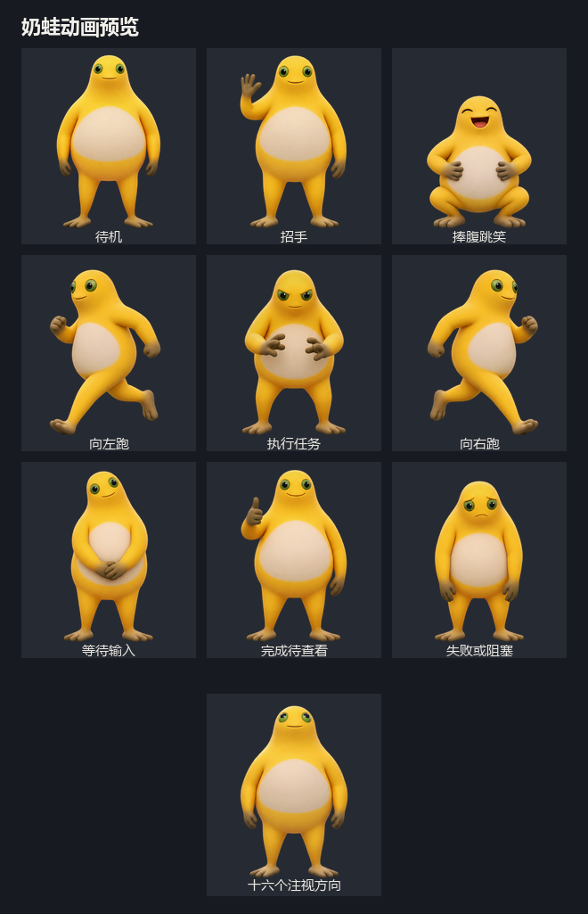

# Naifrog Remastered for Codex

A remastered desktop pet with 9 animation states and 16 gaze directions.

## Install

In Codex Desktop, open Settings > Pets > Custom pets > Open folder. Copy the
`naifrog-remastered` folder into that directory, refresh the list, and select the
new pet. The folder includes the manifest and a lossless Codex v2 sprite sheet.

## Credits

The desktop pet format and original project are from
[timerring/codex-pet-naiwa](https://github.com/timerring/codex-pet-naiwa).
The upstream MIT notice is included for the upstream material.
